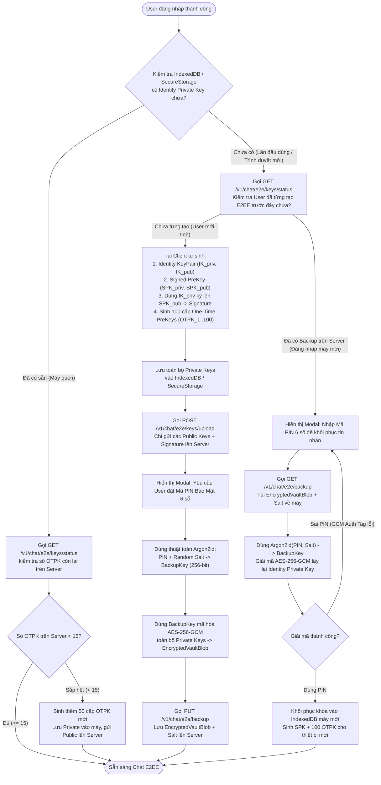
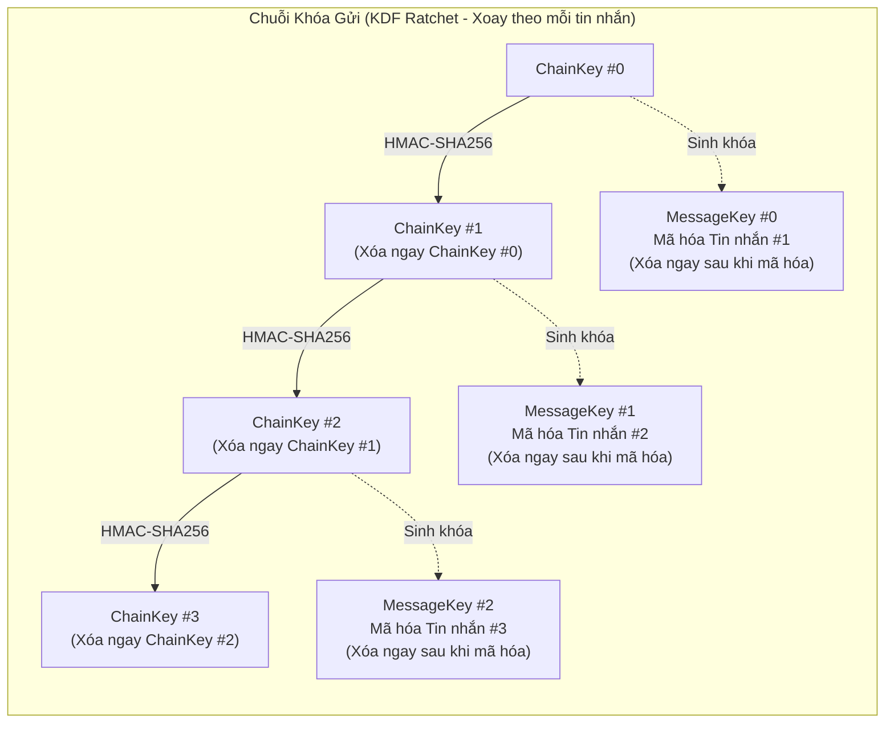
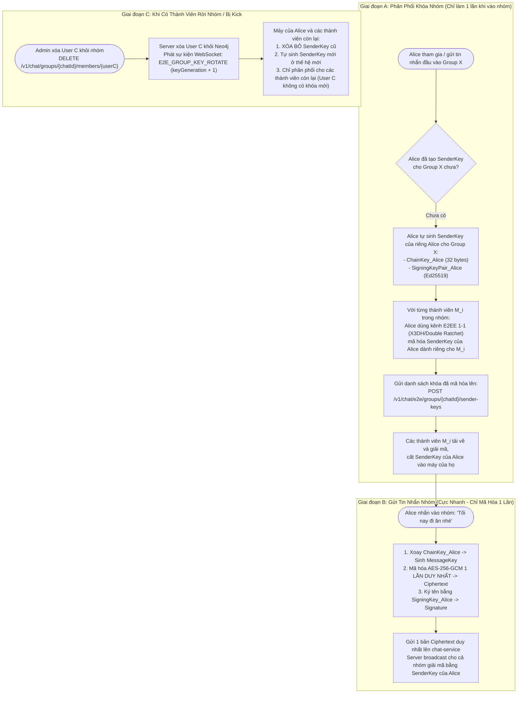

# Kế Hoạch Triển Khai E2EE Chat Chuẩn Chỉ & Giải Thích Luồng Hoạt Động Chi Tiết

Bản tài liệu này vừa là **sổ tay giải thích nguyên lý hoạt động của E2EE từ gốc rễ** (kèm Flowchart chi tiết cho từng kịch bản), vừa là **kế hoạch kỹ thuật chi tiết** để triển khai cho `chat-service`, `file-service`, và `social-network-ui` (Next.js) *(tạm thời bỏ qua `mobile/` theo chỉ thị của Ngài để tập trung hoàn thiện chuẩn chỉnh Web & Backend)*.

---

## PHẦN I: GIẢI THÍCH NGUYÊN LÝ E2EE DỄ HIỂU NHẤT (KÈM FLOWCHART CHI TIẾT)

### 1. Tư Duy Cốt Lõi: E2EE Giải Quyết Bài Toán Gì?

- **Chat thông thường (Hiện tại):**
  `Alice (Bản rõ "Alo")` $\rightarrow$ `Server (Đọc được "Alo", lưu MongoDB "Alo")` $\rightarrow$ `Bob (Nhận "Alo")`.
  Nếu DB bị lộ, hoặc Admin mở MongoDB/MinIO, hoặc Hacker chiếm quyền Server: **Toàn bộ tin nhắn và hình ảnh bị đọc sạch.**

- **Chat E2EE (Mã hóa đầu cuối):**
  `Alice (Bản rõ "Alo")` $\xrightarrow{\text{Mã hóa tại máy Alice}}$ `Bản mã "8f9a2b..."` $\rightarrow$ `Server (Chỉ thấy "8f9a2b...")` $\rightarrow$ `Bob` $\xrightarrow{\text{Giải mã tại máy Bob}}$ `Bản rõ "Alo"`.

> [!TIP]
> **Câu hỏi lớn nhất của E2EE:**
> Làm sao máy của Alice và máy của Bob có chung một **Chìa khóa bí mật (`Shared Secret Key`)** để khóa và mở tin nhắn, trong khi hai người ở xa nhau, chưa từng gặp nhau ngoài đời, chỉ có thể liên lạc qua Server (mà Server lại không được phép biết chìa khóa này), và **thậm chí lúc Alice nhắn tin thì Bob đang tắt máy (Offline)**?

Để giải quyết bài toán này, chuẩn **Signal Protocol** dùng khái niệm **"Hộp ổ khóa mở để sẵn trên Server" (PreKey Bundle)**:

1. Mỗi bộ khóa bất đối xứng (`X25519`) luôn gồm 2 nửa đi cặp với nhau:
   - **Public Key (Ổ khóa mở):** Ai nhìn thấy cũng được, đưa lên Server thoải mái.
   - **Private Key (Chìa khóa mở):** Nằm chết trong máy của chủ nhân, **không bao giờ gửi đi đâu**.
2. **Phép thuật toán học Diffie-Hellman (ECDH):**
   $$\text{DH}(\text{Private Key của Alice}, \text{Public Key của Bob}) == \text{DH}(\text{Private Key của Bob}, \text{Public Key của Alice})$$
   Hai bên chỉ cần lấy **Private Key của mình** kết hợp với **Public Key của đối phương** là tự tính ra **cùng một con số bí mật giống hệt nhau**, trong khi Server đứng giữa chỉ nhìn thấy 2 cái Public Key thì hoàn toàn bó tay, không thể tính ra con số bí mật đó!

---

### 2. Giải Thích 3 Loại Khóa Của Mỗi Người Dùng ("Bộ 3 Ổ Khóa")

Khi Bob đăng ký E2EE, máy của Bob tự sinh ra 3 loại cặp khóa:

| Tên khóa | Ví dụ đời thực | Lưu ở đâu? | Tác dụng |
| :--- | :--- | :--- | :--- |
| **1. Identity Key (`IK`)** | Căn cước công dân của máy Bob | `Private` ở máy Bob, `Public` trên Server | Xác định danh tính lâu dài của Bob, dùng để ký tên xác nhận các ổ khóa bên dưới là của Bob thật chứ không phải do Server tráo. |
| **2. Signed PreKey (`SPK`)** | Ổ khóa chính gắn chữ ký của Bob | `Private` ở máy Bob, `Public` trên Server | Ổ khóa trung hạn (đổi mới mỗi 7–30 ngày). Có chữ ký của `IK` đính kèm. |
| **3. One-Time PreKeys (`OTPK`)** | Rổ 100 ổ khóa dùng 1 lần rồi vứt | `Private` ở máy Bob, `Public` (100 cái) trên Server | Mỗi khi có 1 người lạ nhắn tin cho Bob lúc Bob đang offline, Server phát cho người đó 1 cái ổ khóa trong rổ này rồi **xóa luôn trên Server**. Đảm bảo mỗi cuộc hội thoại mới dùng 1 ổ khóa hoàn toàn khác nhau! |

---

### 3. FLOWCHART 1: Luồng Khởi Tạo Khóa & Tạo "Két Sắt PIN" Khi Đăng Nhập

Luồng này chạy tự động ngay khi người dùng đăng nhập vào Web (`social-network-ui`) hoặc Mobile (`mobile`):



---

### 4. FLOWCHART 2: Luồng Bắt Tay X3DH Khi Alice Nhắn Tin Lần Đầu Cho Bob (Kể Cả Khi Bob Đang Offline)

Giả sử Bob đang ngủ (tắt máy hoàn toàn). Alice muốn nhắn `"Chào Bob, mai họp nhé"` cho Bob. Hai bên chưa từng có chìa khóa chung. Chuyện gì xảy ra?

```mermaid
flowchart TD
    subgraph AliceClient ["1. Tại Máy Của Alice (Người gửi)"]
        A1(["Alice bấm gửi: 'Chào Bob, mai họp nhé'"]) --> A2{"Đã có phiên E2EE (Session)\nvới Bob trong máy chưa?"}
        A2 -- "Chưa có (Nhắn lần đầu)" --> A3["Gọi API: GET /v1/chat/e2e/keys/bundle/bob_id"]
    end

    subgraph ChatServer ["2. Tại Chat Service (Server)"]
        A3 --> S1["Truy vấn MongoDB:\n1. Lấy IK_pub và SPK_pub của Bob từ e2e_device_keys\n2. Dùng FindOneAndDelete lấy 1 khóa OTPK_pub #42\ntừ e2e_one_time_prekeys và XÓA NGAY khỏi DB"]
        S1 --> S2["Trả PreKey Bundle về cho Alice:\n{IK_B_pub, SPK_B_pub, SPK_sig, OTPK_B42_pub}"]
    end

    subgraph AliceCrypto ["3. Máy Alice Tự Tính Chìa Khóa Chung (X3DH)"]
        S2 --> A4["Kiểm tra chữ ký SPK_sig bằng IK_B_pub\n(Chống Server giả mạo ổ khóa)"]
        A4 --> A5["Alice tự sinh 1 cặp khóa tạm thời:\nEphemeral Key (EK_A_priv, EK_A_pub)"]
        A5 --> A6["Alice thực hiện 4 phép kết hợp Diffie-Hellman:\n- DH1 = DH(IK_A_priv, SPK_B_pub)\n- DH2 = DH(EK_A_priv, IK_B_pub)\n- DH3 = DH(EK_A_priv, SPK_B_pub)\n- DH4 = DH(EK_A_priv, OTPK_B42_pub)"]
        A6 --> A7["Đưa (DH1 || DH2 || DH3 || DH4) qua hàm băm HKDF-SHA256\n==> Sinh ra Khóa Gốc: RootKey (SK) + MessageKey #1"]
        A7 --> A8["Dùng MessageKey #1 mã hóa AES-256-GCM:\n'Chào Bob, mai họp nhé' ==> Ciphertext: 'x9K2mP...'"]
        A8 --> A9["Đóng gói gửi lên Server:\n- content: 'x9K2mP...'\n- isEncrypted: true\n- e2eHeader: {IK_A_pub, EK_A_pub, usedOTPKId: 42, iv}"]
    end

    subgraph ServerRelay ["4. Lưu Trữ & Chuyển Tiếp Tại Server"]
        A9 --> S3["Lưu vào MongoDB messages\n(Server chỉ thấy 'x9K2mP...', không biết nội dung)\nBắn FCM: 'Bạn có 1 tin nhắn được mã hóa mới'"]
    end

    subgraph BobClient ["5. Tại Máy Của Bob (Khi Bob Mở Máy Lên)"]
        S3 --> B1["Bob tải tin nhắn về:\nNhận được Ciphertext 'x9K2mP...' + e2eHeader"]
        B1 --> B2["Đọc e2eHeader thấy:\n- IK_A_pub, EK_A_pub của Alice\n- usedOTPKId = 42"]
        B2 --> B3["Bob mở IndexedDB của mình lấy:\nIK_B_priv, SPK_B_priv, và OTPK_B42_priv"]
        B3 --> B4["Bob thực hiện 4 phép tính đối xứng ngược lại:\n- DH1 = DH(SPK_B_priv, IK_A_pub)\n- DH2 = DH(IK_B_priv, EK_A_pub)\n- DH3 = DH(SPK_B_priv, EK_A_pub)\n- DH4 = DH(OTPK_B42_priv, EK_A_pub)"]
        B4 --> B5["Đưa (DH1 || DH2 || DH3 || DH4) qua HKDF-SHA256\n==> Thu được RootKey (SK) + MessageKey #1 GIỐNG HỆT ALICE!"]
        B5 --> B6["Xóa vĩnh viễn OTPK_B42_priv khỏi máy Bob\nDùng MessageKey #1 giải mã 'x9K2mP...'\n==> Hiển thị: 'Chào Bob, mai họp nhé'"]
    end
```



---

### 5. FLOWCHART 3: Cơ Chế "Bánh Cóc Kép" (Double Ratchet) — Đổi Chìa Khóa Cho Từng Tin Nhắn

Sau khi Alice và Bob đã có chung `RootKey (SK)` từ bước X3DH ở trên, nếu họ dùng mãi 1 chìa khóa đó cho 10.000 tin nhắn tiếp theo thì rất nguy hiểm (lộ 1 khóa là lộ toàn bộ).

Do đó, **Double Ratchet** hoạt động như dây xích xe đạp chỉ quay tiến về phía trước mà không thể quay lùi:



- **Tại sao gọi là Double Ratchet (Bánh cóc kép)?**
  1. **Bánh cóc 1 (Symmetric KDF Ratchet):** Khi Alice gửi liên tiếp Tin nhắn #1, #2, #3, mỗi tin nhắn đẩy `ChainKey` tiến lên 1 nấc (`ChainKey #0 -> #1 -> #2`) và xóa khóa cũ ngay lập tức. Vì hàm băm `HMAC-SHA256` là một chiều, dù hacker có cướp được máy của Alice ở thời điểm Tin nhắn #3 (lấy được `ChainKey #2`), hacker **không thể tính ngược lại** `ChainKey #0` hay `ChainKey #1` để đọc Tin nhắn #1, #2! (Đây gọi là **Forward Secrecy**).
  2. **Bánh cóc 2 (Diffie-Hellman Ratchet):** Ngay khi Bob nhắn tin trả lời lại Alice, máy Bob tự động sinh một cặp khóa tạm mới (`RatchetPublicKey` mới) đính kèm vào Header. Máy Alice nhận được sẽ trộn với `RootKey` hiện tại để tạo ra một `RootKey` hoàn toàn mới! Nhờ vậy, dù trước đó hacker từng trộm được khóa trong máy Alice, ngay khi Bob trả lời một tin nhắn, khóa của hacker trở thành vô dụng đối với mọi tin nhắn về sau! (Đây gọi là **Post-Compromise Security / Tự phục hồi sau khi lộ khóa**).

---

### 6. FLOWCHART 4: Luồng Mã Hóa File, Ảnh & Tin Nhắn Thoại (E2EE Media)

Với File/Ảnh/Voice, ta **không nhét cả file vài chục MB vào MongoDB hay WebSocket**, mà kết hợp `file-service` (MinIO) và `chat-service` như sau:

```mermaid
flowchart TD
    subgraph Sender ["1. Tại Máy Người Gửi (Web / Mobile)"]
        F1(["User chọn gửi file 'hop_dong.pdf' hoặc ghi âm Voice"]) --> F2["Sinh ngẫu nhiên tại Client:\n- FileKey (32 bytes / 256-bit)\n- FileIV (12 bytes / 96-bit)"]
        F2 --> F3["Mã hóa file nhị phân bằng AES-256-GCM(FileKey, FileIV)\n==> Thu được EncryptedFileBlob (File rác nhị phân)"]
        F3 --> F4["Tính mã băm kiểm tra toàn vẹn:\nsha256Hash = SHA256(EncryptedFileBlob)"]
        F4 --> F5["Upload EncryptedFileBlob lên file-service\n(POST /v1/files/upload)"]
    end

    subgraph FileSvc ["2. Tại File Service & MinIO"]
        F5 --> M1["Lưu EncryptedFileBlob vào MinIO\n(MinIO chỉ lưu cục dữ liệu đã mã hóa, mở ra không xem được)\nTrả về fileId = 'abc-123'"]
    end

    subgraph ChatMsg ["3. Đóng Gói Khóa Giải Mã File Vào Tin Nhắn E2EE"]
        M1 --> F6["Tạo JSON Metadata tại Client:\n{\n  text: 'Gửi bạn hợp đồng',\n  fileId: 'abc-123',\n  fileName: 'hop_dong.pdf',\n  mimeType: 'application/pdf',\n  fileKey: '<Base64_32_Bytes>',\n  fileIV: '<Base64_12_Bytes>',\n  sha256: '<Hex_Hash>'\n}"]
        F6 --> F7["Mã hóa chuỗi JSON trên bằng Double Ratchet\n==> Ciphertext"]
        F7 --> F8["Gửi POST /v1/chat/send-file kèm Ciphertext + e2eHeader"]
    end

    subgraph Receiver ["4. Tại Máy Người Nhận"]
        F8 --> R1["Giải mã Ciphertext bằng Double Ratchet\n==> Lấy được JSON chứa {fileId, fileKey, fileIV, sha256}"]
        R1 --> R2["Tải EncryptedFileBlob từ Presigned URL (/v1/files/abc-123)"]
        R2 --> R3["Kiểm tra SHA256(EncryptedFileBlob) == sha256\n(Đảm bảo file trên MinIO không bị tráo đổi)"]
        R3 --> R4["Giải mã AES-256-GCM(EncryptedFileBlob, fileKey, fileIV)\n==> Hiển thị ảnh / Phát âm thanh Voice / Tải file gốc!"]
    end
```



---

### 7. FLOWCHART 5: Luồng Mã Hóa Nhóm (Group Chat Sender Keys)

Trong nhóm 50 người, nếu dùng cơ chế 1-1 thì mỗi lần Alice gửi 1 câu `"Hello"`, máy Alice phải mã hóa 50 lần và gửi 50 bản mã lên Server. Để tối ưu, chuẩn **Sender Keys** hoạt động như sau:



---

## PHẦN II: THIẾT KẾ KỸ THUẬT CHI TIẾT TRÊN CODEBASE

### 1. Các Collections Mới Trong MongoDB (`chat-service/db/mongo.go`)

1. **`e2e_device_keys`**: Lưu `IdentityKeyPub`, `SignedPreKeyPub`, `SignedPreKeySig` của từng thiết bị (`<userId>:<deviceId>`).
2. **`e2e_one_time_prekeys`**: Lưu danh sách `OneTimePreKey` (`<userId>:<deviceId>:<keyId>`). Khi có người yêu cầu bundle, dùng `FindOneAndDelete` nguyên tử để lấy ra 1 khóa và xóa ngay khỏi DB.
3. **`e2e_group_sender_keys`**: Lưu các gói `EncryptedSenderKey` phân phối giữa các thành viên trong Group Chat.
4. **`e2e_key_backups`**: Lưu `EncryptedVault` + tham số `Argon2id` (`KDFSalt`, `KDFMemoryKB`, `KDFIterations`) để đồng bộ đa thiết bị.

### 2. Cập Nhật Model `Message` (`chat-service/model/model.go`)

```go
type E2EHeader struct {
	Version           int     `json:"version" bson:"version"`                                         // 1
	Algorithm         string  `json:"algorithm" bson:"algorithm"`                                     // "X3DH_DR_V1" | "SENDER_KEY_V1"
	SenderDeviceID    string  `json:"senderDeviceId" bson:"sender_device_id"`
	RecipientDeviceID string  `json:"recipientDeviceId,omitempty" bson:"recipient_device_id,omitempty"`
	SenderIdentityKey string  `json:"senderIdentityKey,omitempty" bson:"sender_identity_key,omitempty"` // Chỉ đính kèm ở các tin nhắn khởi tạo phiên X3DH
	EphemeralKey      string  `json:"ephemeralKey,omitempty" bson:"ephemeral_key,omitempty"`           // Khóa EK_A (X3DH) hoặc Ratchet Public Key hiện tại
	SignedPreKeyID    *uint32 `json:"signedPreKeyId,omitempty" bson:"signed_pre_key_id,omitempty"`
	OneTimePreKeyID   *uint32 `json:"oneTimePreKeyId,omitempty" bson:"one_time_pre_key_id,omitempty"`
	ChainIndex        uint32  `json:"chainIndex" bson:"chain_index"`                                   // Thứ tự tin nhắn N trong chuỗi Ratchet
	PreviousChainLen  uint32  `json:"previousChainLen,omitempty" bson:"previous_chain_len,omitempty"`   // Số lượng tin nhắn của chuỗi Ratchet trước (PN)
	KeyGeneration     uint32  `json:"keyGeneration,omitempty" bson:"key_generation,omitempty"`         // Thế hệ khóa nhóm (tăng khi xoay khóa)
	IV                string  `json:"iv" bson:"iv"`                                                   // 12-byte GCM Nonce (Base64)
	Signature         string  `json:"signature,omitempty" bson:"signature,omitempty"`                  // Chữ ký Ed25519
}
```

### 3. Danh Sách REST Endpoints Mới Tại `chat-service`

| Method | Endpoint | Chức năng |
| :--- | :--- | :--- |
| `POST` | `/v1/chat/e2e/keys/upload` | Đăng ký `IdentityKeyPub`, `SignedPreKey` và lô `OneTimePreKeys` ban đầu |
| `POST` | `/v1/chat/e2e/keys/prekeys` | Bổ sung thêm `OneTimePreKeys` khi nhận cảnh báo `E2E_LOW_PREKEYS` |
| `GET` | `/v1/chat/e2e/keys/status` | Kiểm tra trạng thái khóa và số lượng `OneTimePreKeys` còn lại của bản thân |
| `GET` | `/v1/chat/e2e/keys/bundle/:targetUserId` | Lấy `PreKeyBundle` của người nhận (tự động pop & xóa 1 `OneTimePreKey`) |
| `DELETE` | `/v1/chat/e2e/devices/:deviceId` | Xóa thiết bị cũ và thu hồi toàn bộ prekeys của thiết bị đó |
| `PUT` | `/v1/chat/e2e/backup` | Upload két sắt khóa (`EncryptedVault`) đã mã hóa bằng mã PIN |
| `GET` | `/v1/chat/e2e/backup` | Tải `EncryptedVault` về máy mới để giải mã bằng mã PIN |
| `POST` | `/v1/chat/e2e/groups/:chatId/sender-keys` | Phân phối `SenderKey` đã mã hóa cho các thành viên trong nhóm |
| `GET` | `/v1/chat/e2e/groups/:chatId/sender-keys` | Lấy danh sách `SenderKey` của các thành viên trong nhóm `:chatId` |

---

## PHẦN III: LỘ TRÌNH TRIỂN KHAI TỪNG BƯỚC (ROADMAP)

1. **Phase 1 — Hạ tầng Backend E2EE (`chat-service`):**
   - Mở rộng `chat-service/model/model.go` và `chat-service/db/mongo.go` với 4 collections lưu khóa công khai & backup.
   - Xây dựng `e2e_service.go` và `e2e_handler.go` cho các API quản lý khóa, atomic pop `OneTimePreKey`, key backup và group sender keys.
   - Cập nhật `chat-service/service/chat_service.go` và `chat-service/handler/chat_handler.go` để truyền `isEncrypted` + `e2eHeader`, ẩn nội dung bản mã khi gửi Push Notification (FCM/Kafka), và phát sự kiện xoay khóa nhóm khi xóa thành viên.
2. **Phase 2 — Bộ máy Mật mã học & Chat 1-1 trên Web (`social-network-ui`):**
   - Xây dựng thư viện `src/utils/e2ee/` (`cryptoEngine.js`, `keyStore.js`, `x3dh.js`, `doubleRatchet.js`, `pinBackup.js`).
   - Tích hợp tự động mã hóa/giải mã vào `useChat.js`, `useSendMessageSocket.js`, `ChatList.jsx` và `ChatBox.jsx`.
   - Thêm Modal thiết lập / khôi phục mã PIN E2EE và màn hình kiểm tra **Safety Number (Fingerprint)**.
3. **Phase 3 — Mã hóa File, Ảnh, Voice & Group Chat E2EE:**
   - Tích hợp mã hóa/giải mã file binary (`mediaCrypto.js`) trước khi upload lên `file-service`.
   - Tích hợp giao thức `Sender Keys` cho Group Chat và tự động xoay khóa khi thành viên rời nhóm.
4. **Phase 4 — Kiểm thử Toàn diện & Mở rộng (Verification & Staging):**
   - Kiểm thử đa trình duyệt Web (Chrome, Firefox, Safari) và các tab ẩn danh (Incognito).
   - Kiểm thử các trường hợp mạng lag, gói tin đến lệch thứ tự (Out-of-Order).
   - Kiểm thử sao lưu / khôi phục khóa qua mã PIN khi đăng nhập thiết bị mới hoặc xóa cache trình duyệt.
   - *(Dành phần `mobile/` sang giai đoạn sau khi app mobile đã ổn định)*.
