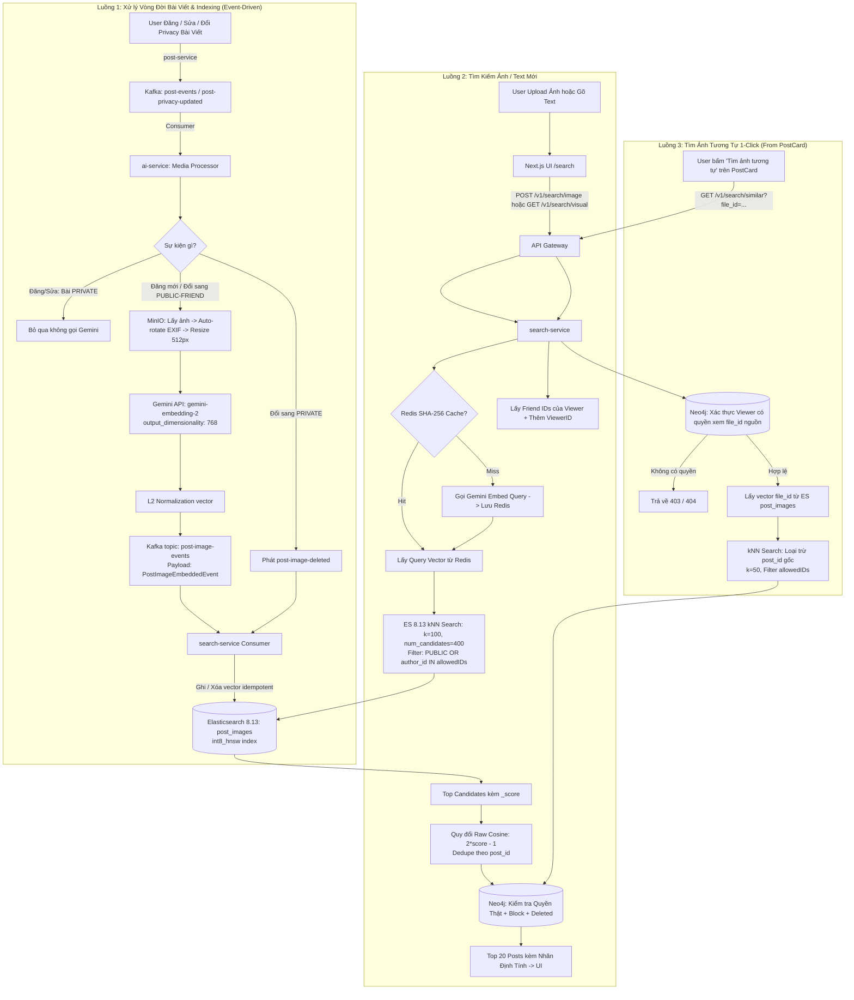

# Kế Hoạch Chi Tiết: Triển Khai Tìm Kiếm Bằng Hình Ảnh Qua Vector DB (Visual Search) - v3.0 (Production-Ready)

## 1. Tổng Quan & Kiến Trúc Chuẩn Hóa Toàn Diện

Bản kế hoạch v3.0 chuẩn hóa triệt để các góc cạnh kỹ thuật, quyền riêng tư, toán học đo lường và ranh giới hệ thống:

1. **Chuẩn hóa thang đo Cosine thô (Raw Cosine $\in [-1, 1]$)**:
   * Quy đổi toàn diện `_score` của Elasticsearch $(\frac{1+\cos}{2})$ về Cosine thô: $\cos = 2 \cdot \text{score} - 1$.
   * Không hardcode số liệu; các ngưỡng `min_score` cho Image-to-Image và Text-to-Image được cấu hình động qua Runtime Config / Redis và được chốt sau khi chạy bộ test Relevance.
2. **Quyền riêng tư 2 lớp hoàn chỉnh (Two-tier Privacy Defense)**:
   * **Lớp 1 (ES kNN Pre-filter)**: Lọc thô trước khi vector search: `PUBLIC` $\lor$ `author_id == viewerID` $\lor$ (`FRIEND` $\land$ `author_id` $\in$ `[friend_ids]`). Khắc phục triệt để lỗi mất bài của chính viewer và chống cạn kiệt candidate.
   * **Lớp 2 (Neo4j Final Defense-in-depth)**: Kiểm tra lại 100% bằng Cypher graph thật để bắt các ca Redis friend list bị stale (vừa unfriend/block chưa kịp invalidate).
3. **Xử lý toàn diện vòng đời bài viết (Lifecycle & Privacy Transition Edge Cases)**:
   * `PRIVATE` $\rightarrow$ `PUBLIC`/`FRIEND`: `ai-service` bắt event `post-privacy-updated` để embed bổ sung.
   * `PUBLIC`/`FRIEND` $\rightarrow$ `PRIVATE`: `search-service` lập tức xóa vector khỏi index `post_images`.
   * Sửa bài (gỡ ảnh, thêm ảnh): Xóa vector ảnh cũ, embed ảnh mới.
4. **Bảo mật Endpoint Similar Search 1-Click (`GET /v1/search/similar?file_id=...`)**:
   * Kiểm tra quyền xem bài viết gốc chứa `file_id` trước khi truy xuất vector (chống brute-force dò tìm ảnh bài riêng tư bằng file_id).
5. **Ranh giới dịch vụ & Tối ưu hóa**:
   * Thống nhất tên topic: `post-image-events`, struct: `PostImageEmbeddedEvent`.
   * Script Backfill nằm ngoài, chỉ phát lại event vào Kafka có throttling để `ai-service` xử lý, không tự gọi Gemini.
   * Thêm `embedding_model` và `model_version` vào mapping ES; cache Redis có prefix theo tên model.
   * Auto-rotate ảnh theo EXIF trước khi resize; áp dụng `int8_hnsw` trên Elasticsearch 8.13 giảm 75% RAM vector.
   * Cam kết dùng gói trả phí Gemini API (Tier 1+ Pay-as-you-go) bảo đảm không sử dụng dữ liệu người dùng để huấn luyện model.

---

## 2. Sơ Đồ Kiến Trúc Luồng Dữ Liệu (Production Architecture)



---

## 3. Chi Tiết Kỹ Thuật Từng Hạng Mục

### 3.1. Thống Nhất Thang Đo Cosine & Ngưỡng Tương Đồng
* **Toán học quy đổi**:
  * Elasticsearch Cosine `_score` có công thức: $S_{\text{ES}} = \frac{1 + \cos(\theta)}{2} \in [0, 1]$.
  * Giá trị Cosine thô:
    $$\cos(\theta) = 2 \cdot S_{\text{ES}} - 1 \in [-1, 1]$$
* **Chiến lược ngưỡng lọc (Threshold Strategy)**:
  * Sử dụng thống nhất thang **Cosine thô** trên toàn bộ hệ thống (từ backend đến log).
  * Backend cấu hình 2 biến runtime (có thể cập nhật qua Redis / Runtime Config):
    * `visual_search.image_similarity_min`: Mặc định tạm thời $0.60$ (tương đương $S_{\text{ES}} = 0.80$).
    * `visual_search.text_similarity_min`: Mặc định tạm thời $0.20$ (tương đương $S_{\text{ES}} = 0.60$).
  * **Chốt ngưỡng chính thức**: Sẽ tinh chỉnh sau khi chạy bộ test Relevance (Mục 5).
* **Nhãn định tính trên UI (Qualitative Labels)**:
  * Image-to-Image (dựa trên Cosine thô):
    * $\cos \ge 0.75$: **"Rất giống"** (Huy hiệu xanh lá)
    * $0.60 \le \cos < 0.75$: **"Tương đồng cao"** (Huy hiệu xanh dương)
    * $0.50 \le \cos < 0.60$: **"Có nét tương đồng"** (Huy hiệu xám)
    * $\cos < 0.50$: Tự động loại bỏ.
  * Text-to-Image:
    * $\cos \ge 0.35$: **"Rất phù hợp mô tả"**
    * $0.20 \le \cos < 0.35$: **"Khá liên quan"**
    * $\cos < 0.20$: Tự động loại bỏ.

---

### 3.2. Cấu Trúc Mapping Elasticsearch 8.13 với `int8_hnsw`
* **File**: `search-service/db/elasticsearch.go`
* **Index**: `post_images`
* **Mapping Schema**:
  ```json
  {
    "settings": {
      "index": {
        "number_of_shards": 1,
        "number_of_replicas": 0
      }
    },
    "mappings": {
      "properties": {
        "id": { "type": "keyword" },
        "post_id": { "type": "keyword" },
        "file_id": { "type": "keyword" },
        "author_id": { "type": "keyword" },
        "privacy": { "type": "keyword" },
        "embedding_model": { "type": "keyword" },
        "model_version": { "type": "keyword" },
        "image_vector": {
          "type": "dense_vector",
          "dims": 768,
          "index": true,
          "similarity": "cosine",
          "index_options": {
            "type": "int8_hnsw",
            "m": 16,
            "ef_construction": 100
          }
        },
        "created_at": { "type": "date" }
      }
    }
  }
  ```
  *(Sử dụng `int8_hnsw` giúp giảm dung lượng RAM cho vector từ ~3KB xuống ~0.75KB/ảnh, tiết kiệm 75% bộ nhớ đệm của Elasticsearch).*

---

### 3.3. Câu Lệnh Elasticsearch kNN Query với Pre-filter Hoàn Chỉnh
* **File**: `search-service/repository/elasticsearch_repository.go`
* **Query Builder**:
  ```json
  {
    "knn": {
      "field": "image_vector",
      "query_vector": [...],
      "k": 100,
      "num_candidates": 400,
      "similarity": <cosine_min_threshold>,
      "filter": {
        "bool": {
          "must_not": [
            { "term": { "post_id": "<exclude_post_id>" } }
          ],
          "should": [
            { "term": { "privacy": "PUBLIC" } },
            { "term": { "author_id": "<viewer_id>" } },
            {
              "bool": {
                "must": [
                  { "term": { "privacy": "FRIEND" } },
                  { "terms": { "author_id": ["<friend_1>", "<friend_2>", ...] } }
                ]
              }
            }
          ],
          "minimum_should_match": 1
        }
      }
    }
  }
  ```
  *(Bảo đảm bài của chính viewer `author_id == viewer_id` luôn được tính hợp lệ).*

---

### 3.4. Kiểm Tra Quyền Riêng Tư Chốt Chặn trên Neo4j (Defense-in-depth)
* **File**: `search-service/service/search_service.go`
* **Cypher Query Verification**:
  ```cypher
  MATCH (viewer:User {id: $viewerID})
  MATCH (author:User)-[:POSTED]->(p:Post)
  WHERE p.id IN $candidatePostIDs
    AND p.deletedAt IS NULL
    AND NOT (viewer)-[:BLOCK]-(author)
    AND (
      p.privacy = 'PUBLIC'
      OR author.id = viewer.id
      OR (p.privacy = 'FRIEND' AND EXISTS((viewer)-[:FRIEND]-(author)))
    )
  RETURN p.id AS postID, author.id AS authorID, p.content AS content,
         p.privacy AS privacy, p.files AS files, p.likeCount AS likeCount,
         p.commentCount AS commentCount, p.createdAt AS createdAt
  ```
  *Bắt trọn vẹn trường hợp danh sách bạn bè ở Redis cache bị cũ khi hai tài khoản vừa unfriend hoặc block nhau.*

---

### 3.5. Kiểm Tra Quyền Xem Ảnh Gốc (Source Image Authorization)
* **Endpoint**: `GET /v1/search/similar?file_id=...`
* **Quy trình xác thực**:
  1. Nhận `file_id` từ query parameter.
  2. Truy vấn Neo4j để tìm bài viết chứa `file_id` này và kiểm tra quyền của `viewerID`:
     ```cypher
     MATCH (viewer:User {id: $viewerID})
     MATCH (author:User)-[:POSTED]->(p:Post)
     WHERE $fileID IN p.files
       AND p.deletedAt IS NULL
       AND NOT (viewer)-[:BLOCK]-(author)
       AND (
         p.privacy = 'PUBLIC'
         OR author.id = viewer.id
         OR (p.privacy = 'FRIEND' AND EXISTS((viewer)-[:FRIEND]-(author)))
       )
     RETURN p.id AS postID
     ```
  3. Nếu không tìm thấy hoặc viewer không có quyền xem bài gốc $\rightarrow$ Trả về `403 Forbidden` / `404 Not Found`.
  4. Nếu hợp lệ $\rightarrow$ Lấy vector của `file_id` trong ES, chạy kNN (loại trừ `post_id` gốc).

---

### 3.6. Xử Lý Vòng Đời Privacy & Cập Nhật Bài Viết (Lifecycle Events)
* **Event Topic**: `post-events` và `post-privacy-updated`
* **Các kịch bản**:
  1. **Bài chuyển `PRIVATE` $\rightarrow$ `PUBLIC` hoặc `FRIEND`**:
     * `ai-service` nhận event `post-privacy-updated`: kiểm tra nếu trạng thái cũ là `PRIVATE` và mới là `PUBLIC`/`FRIEND` $\rightarrow$ Đọc ảnh từ MinIO, gọi Gemini embed và phát event `post-image-events`.
  2. **Bài chuyển `PUBLIC`/`FRIEND` $\rightarrow$ `PRIVATE`**:
     * `search-service` nhận event `post-privacy-updated`: Xóa toàn bộ document của `post_id` khỏi index `post_images`.
  3. **Bài bị xóa (`post-deleted`)**:
     * `search-service` xóa tất cả vector của `post_id`.
  4. **Bài sửa ảnh (`post-updated`)**:
     * So sánh `oldFiles` và `newFiles`:
       * Các file bị gỡ: `search-service` xóa vector tương ứng.
       * Các file mới thêm: `ai-service` embed và phát event index bổ sung.

---

### 3.7. Tiền Xử Lý Hình Ảnh: Auto-rotate EXIF & Resize
* **File**: `ai-service/service/image_processor.go`
* **Quy trình**:
  1. Đọc byte buffer ảnh từ MinIO.
  2. Kiểm tra MIME type: Chỉ xử lý `image/jpeg`, `image/png`, `image/webp`. Bỏ qua video, gif động, audio.
  3. **Auto-rotate theo EXIF Orientation**: Đọc tag EXIF và xoay ma trận pixel về hướng chuẩn (tránh trường hợp ảnh chụp dọc từ iPhone/Android bị quay ngang khi embed).
  4. **Resize**: Thu nhỏ cạnh dài nhất về tối đa $512\text{px}$ giữ nguyên tỷ lệ khung hình (Aspect Ratio).
  5. Encode sang chuẩn JPEG trước khi chuyển base64 sang Gemini API.

---

### 3.8. Ranh Giới Dịch Vụ & Kiến Trúc Backfill Throttled
* **Event Struct Chuẩn**:
  ```go
  type PostImageEmbeddedEvent struct {
      PostID         string    `json:"postId"`
      FileID         string    `json:"fileId"`
      AuthorID       string    `json:"authorId"`
      Privacy        string    `json:"privacy"`
      EmbeddingModel string    `json:"embeddingModel"`
      ModelVersion   string    `json:"modelVersion"`
      Vector         []float32 `json:"vector"`
      CreatedAt      time.Time `json:"createdAt"`
  }
  ```
* **Topic Name**: `post-image-events` (thống nhất trong toàn bộ codebase).
* **Script Backfill (`scripts/backfill_image_embeddings.go`)**:
  * Chạy độc lập, kết nối Neo4j quét các bài viết có ảnh (`PUBLIC` và `FRIEND`).
  * Có cơ chế Rate Limiting (ví dụ tối đa 60 bài/phút phù hợp hạn mức Gemini).
  * Phát sự kiện vào Kafka `post-events` để `ai-service` thực hiện embed tuần tự.
  * Lưu trạng thái `last_post_id` vào file/Redis checkpoint để có thể dừng/chạy lại bất kỳ lúc nào.

---

### 3.9. Bảo Mật Endpoint, Caching & Chính Sách Dữ Liệu
1. **Rate Limiting**:
   * Upload ảnh mới (`POST /v1/search/image`): 10 requests / phút / user.
   * Text search (`GET /v1/search/visual`): 30 requests / phút / user.
   * 1-Click Similar (`GET /v1/search/similar`): 60 requests / phút / user.
2. **Redis Vector Cache**:
   * Khóa cache ảnh: `cache:vector:<embedding_model>:sha256:<sha256_hash_of_image>`.
   * Khóa cache text: `cache:vector:<embedding_model>:text:<sha256_hash_of_normalized_text>`.
   * TTL: 7 ngày cho ảnh, 24 giờ cho text.
3. **Cam kết Bảo Mật Dữ Liệu Gemini**:
   * Bắt buộc sử dụng Gemini API với tài khoản trả phí (Tier 1+ Pay-As-You-Go) để tuân thủ điều khoản không huấn luyện dữ liệu của Google.
   * Cập nhật điều khoản bảo mật của ứng dụng (Privacy Policy) về việc xử lý đặc trưng hình ảnh qua AI.

---

## 4. Kế Hoạch Triển Khai Từng Bước (Implementation Phases)

### Phase 1: Chuẩn Bị Hạ Tầng Vector & Mapping Elasticsearch (search-service)
- [ ] **Task 1.1**: Định nghĩa schema mapping cho index `post_images` trong [elasticsearch.go](file:///home/thang/coding/social-network-go/search-service/db/elasticsearch.go) với `dense_vector`, `dims: 768`, `similarity: "cosine"`, `int8_hnsw`, `embedding_model`, `model_version`.
- [ ] **Task 1.2**: Bổ sung hàm `EnsureIndices` tự động tạo index `post_images` khi khởi động.
- [ ] **Task 1.3**: Xây dựng Repository Methods trong [elasticsearch_repository.go](file:///home/thang/coding/social-network-go/search-service/repository/elasticsearch_repository.go):
  - `IndexPostImage`, `DeletePostImagesByPost`, `DeletePostImageByFile`, `GetImageVectorByFileID`.
  - `SearchSimilarImagesWithFilter`: Thực hiện kNN query với allowed authors (`PUBLIC` + `viewerID` + `friendIDs`).
  - Hàm helper chuyển đổi Cosine: `ToRawCosine(score float64) float64`.

### Phase 2: Pipeline Sinh Embedding (ai-service) & Đồng Bộ Qua Kafka
- [ ] **Task 2.1**: Xây dựng client gọi Gemini Multimodal Embedding trong `ai-service`:
  - Request cấu hình `output_dimensionality: 768`.
  - Hàm chuẩn hóa vector `L2Normalize(vec []float32) []float32`.
- [ ] **Task 2.2**: Module tiền xử lý hình ảnh (`image_processor.go`): EXIF Auto-rotate, resize max 512px, convert JPEG.
- [ ] **Task 2.3**: Xây dựng Kafka Publisher trong `ai-service`:
  - Lắng nghe `post-events` và `post-privacy-updated`.
  - Bỏ qua bài `PRIVATE`.
  - Embed ảnh từ MinIO $\rightarrow$ Publish sang Kafka topic `post-image-events`.
- [ ] **Task 2.4**: Xây dựng Consumer trong [search-service/consumer/](file:///home/thang/coding/social-network-go/search-service/consumer/):
  - Consume topic `post-image-events` và ghi trực tiếp vào Elasticsearch index `post_images`.
  - Xử lý các event xóa/đổi privacy bài viết.
- [ ] **Task 2.5**: Xây dựng script Backfill độc lập (`scripts/backfill_image_embeddings.go`) có checkpoint và rate limit.

### Phase 3: Hoàn Thiện API Tìm Kiếm & Bảo Vệ Hệ Thống (search-service)
- [ ] **Task 3.1**: Cơ chế bảo vệ: Giới hạn MIME type, file size $\le 5\text{MB}$, Rate limit, SHA-256 Vector Cache trên Redis cho cả ảnh và văn bản.
- [ ] **Task 3.2**: Logic Dedupe theo `post_id` (chỉ giữ ảnh có cosine cao nhất) và Neo4j defense-in-depth (kiểm tra quyền thật, block, bài mới xóa).
- [ ] **Task 3.3**: Mở 3 endpoints trong [search_handler.go](file:///home/thang/coding/social-network-go/search-service/handler/search_handler.go):
  - `POST /v1/search/image`: Upload ảnh mới.
  - `GET /v1/search/visual?query=...`: Text-to-Image.
  - `GET /v1/search/similar?file_id=...`: 1-Click Similar Search có xác thực quyền trên file nguồn.

### Phase 4: Bộ Test Relevance & Tối Ưu Giao Diện (UI & Testing)
- [ ] **Task 4.1**: Viết Unit & Integration tests cho toàn bộ ca biên quyền riêng tư:
  - Ca hai người vừa hủy kết bạn.
  - Ca bài viết của chính viewer.
  - Ca chuyển đổi privacy `PRIVATE` $\leftrightarrow$ `PUBLIC`/`FRIEND`.
  - Ca gọi `/search/similar` với `file_id` của bài người khác không có quyền xem.
- [ ] **Task 4.2**: Xây dựng và chạy bộ **Relevance Test Dataset** (30-50 queries thực tế) để đo đạc và chốt các ngưỡng `min_score` Cosine chính thức.
- [ ] **Task 4.3**: Tích hợp UI trên [search/page.js](file:///home/thang/coding/social-network-go/social-network-ui/src/app/(home)/search/page.js) và [PostCard.js](file:///home/thang/coding/social-network-go/social-network-ui/src/components/social-app-component/PostCard.js) với nhãn định tính ("Rất giống", "Khá giống").

---

## 5. Mục Tiêu SLA Thực Tế

| Thao tác | SLA P50 | SLA P95 | Điều kiện |
| :--- | :---: | :---: | :--- |
| **Tìm kiếm bằng ảnh mới upload** | $\le 600\text{ms}$ | $\le 1.2\text{s}$ | Ảnh mới chưa có trong cache Redis. |
| **Tìm kiếm bằng ảnh đã có cache** | $\le 80\text{ms}$ | $\le 150\text{ms}$ | SHA-256 cache hit, bỏ qua bước gọi Gemini. |
| **Tìm ảnh tương tự 1-Click (`/similar`)** | $\le 45\text{ms}$ | $\le 80\text{ms}$ | Warm cache, lấy vector trực tiếp từ ES. |
| **Tìm ảnh bằng câu chữ (Text-to-Image)** | $\le 350\text{ms}$ | $\le 700\text{ms}$ | Query text mới. |
