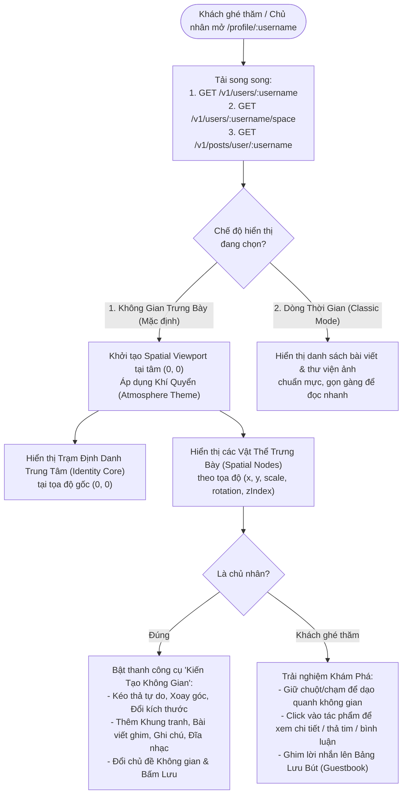

# Kế Hoạch Thiết Kế & Triển Khai: Không Gian Vô Định & Phòng Trưng Bày Cá Nhân (Spatial Profile & Personal Gallery)

Bản kế hoạch này trình bày chi tiết giải pháp lột xác hoàn toàn trang cá nhân (`Profile Page`) từ giao diện danh sách dọc truyền thống sang mô hình **"Không Gian Vô Định & Phòng Trưng Bày Cá Nhân" (`Infinite Spatial Canvas & Curated Gallery`)** — nơi mỗi người dùng là một "giám tuyển" (Curator) tự do kiến tạo thế giới riêng của mình.

---

## PHẦN I: TẦM NHÌN SẢN PHẨM & TRẢI NGHIỆM NGƯỜI DÙNG (UX/UI CONCEPT)

### 1. Vấn Đề Của Trang Cá Nhân Hiện Tại
Hiện tại, [`ProfilePageClient.jsx`](file:///home/thang/coding/social-network-go/social-network-ui/src/app/(home)/profile/[username]/ProfilePageClient.jsx) và [`ProfileHeader.jsx`](file:///home/thang/coding/social-network-go/social-network-ui/src/components/social-app-component/ProfileHeader.jsx) đang đi theo bố cục truyền thống:
- Trên cùng là khối thông tin tĩnh (`Avatar`, `Tên`, `Số liệu`, `Bio`).
- Bên dưới là 2 tab đơn điệu (`Bài viết` xếp dọc và `Phương tiện` xếp lưới vuông).
- Mọi trang cá nhân của mọi người dùng đều có hình hài giống hệt nhau, thiếu cá tính và không tạo được cảm xúc "ghé thăm nhà của một ai đó".

### 2. Ý Tưởng Đột Phá: "Không Gian Vô Định" (Infinite Spatial Canvas)
Thay vì cuộn dọc vô hồn, trang cá nhân trở thành một **Không Gian 2D Mở Rộng (`4000px × 4000px`)** có thể **Kéo (Pan) & Thu phóng (Zoom)** mượt mà ở 60FPS:



---

### 3. Hệ Sinh Thái Các Vật Thể Trong Không Gian (`Spatial Nodes`)

Chủ nhân có thể tự do擺 trí (kéo thả tọa độ `x, y`, xoay nghiêng `rotation`, phóng to/thu nhỏ `scale`, đổi lớp `zIndex`) cho **7 loại vật thể (Artifacts)**:

| Loại Vật Thể (`nodeType`) | Mô Tả Hiển Thị & Tương Tác | Tùy Chỉnh Của Chủ Nhân |
| :--- | :--- | :--- |
| **1. Trạm Định Danh (`IDENTITY_CORE`)** | Tâm điểm của không gian tại `(0, 0)`. Chứa Avatar, Tên, `@username`, Bio, nút Kết bạn / Nhắn tin và số liệu. | Có thể di chuyển vị trí hoặc đổi kiểu khung: `GLASS` (Kính mờ), `GALLERY_PLAQUE` (Biển tên bảo tàng), `COSMIC_ORB` (Tâm tinh cầu), `MINIMAL` (Tối giản). |
| **2. Tác Phẩm Bài Viết (`POST_CARD`)** | Ghim bất kỳ bài viết nào của chủ nhân lên không gian như một tác phẩm triển lãm. Click vào mở chi tiết bài viết, thả tim, bình luận trực tiếp. | Chọn bài viết (`postId`), chọn kiểu khung (`POLAROID`, `MUSEUM_FRAME`, `FLOATING_GLASS`, `MANUSCRIPT`), thêm lời chú thích ngắn của tác giả. |
| **3. Khung Tranh / Phim (`MEDIA_FRAME`)** | Trưng bày ảnh hoặc video độc lập với độ phân giải cao, hiệu ứng chiều sâu (Parallax nhẹ khi di chuột). | Chọn ảnh/video (`fileUrl`), chọn kiểu viền (`GALLERY_MATTE` bo viền trắng dày, `BORDERLESS` tràn viền, `TAPE_PIN` dán băng dính nghệ thuật), nhãn tiêu đề bức ảnh. |
| **4. Ghi Chú & Châm Ngôn (`TEXT_NOTE`)** | Những dòng chữ lơ lửng trong không gian, tờ giấy nhớ (Sticky Note), hoặc câu trích dẫn tâm đắc khổ lớn. | Nội dung văn bản, kiểu chữ (`SERIF_EDITORIAL`, `MONO_TECH`, `HANDWRITTEN`), màu nền giấy hoặc chữ phát sáng trong suốt. |
| **5. Góc Đĩa Than / Âm Thanh (`AUDIO_VINYL`)** | Máy phát nhạc / đĩa than xoay tròn. Khách ghé thăm có thể bấm Play để vừa nghe nhạc/voice của chủ nhân vừa dạo quanh phòng trưng bày. | Chọn file âm thanh hoặc bản thu âm, tiêu đề bản nhạc, màu sắc nhãn đĩa than. |
| **6. Cổng Tinh Tú Bạn Bè (`PORTAL_LINK`)** | Hiển thị bạn thân như những "Cánh cổng không gian" hoặc "Ngôi sao vệ tinh". Click vào lập tức du hành sang không gian của người bạn đó. | Chọn người bạn từ danh sách bạn bè, ghi nhãn kỷ niệm/mối quan hệ. |
| **7. Bảng Lưu Bút (`GUESTBOOK_WALL`)** | Khu vực tương tác đặc biệt: Khách ghé thăm và bạn bè có thể viết một lời nhắn ngắn (kèm màu sắc thẻ) ghim lên bảng lưu bút của chủ nhân. | Bật/tắt quyền cho khách để lại lời nhắn, xóa lời nhắn không phù hợp. |

---

### 4. Bốn Chủ Đề Khí Quyển (`Atmosphere & Environment Presets`)

Chủ nhân có thể biến đổi toàn bộ khí chất của trang cá nhân chỉ bằng 1 cú chạm:

1. **`COSMIC_VOID` (Không Gian Vô Định - Mặc định mới):**
   - Nền đêm vũ trụ sâu thẳm (`#07080D`), lưới tọa độ chấm sao mờ ảo, hiệu ứng ánh sáng cực quang (Ambient Aurora Glow) dịu nhẹ phía sau Trạm Định Danh.
   - Các vật thể trôi nổi nhẹ nhàng (subtle floating animation lệch pha nhau).
2. **`ART_GALLERY` (Phòng Trưng Bày Nghệ Thuật):**
   - Nền tường bảo tàng sắc kem ấm (`#F6F4F0` ở chế độ sáng / `#161514` ở chế độ tối), kết cấu giấy mỹ thuật tinh tế.
   - Các bức ảnh và bài viết có hiệu ứng ánh đèn rọi (Spotlight shadow) từ trên xuống như trong triển lãm thực thụ.
3. **`BLUEPRINT_STUDIO` (Xưởng Sáng Tạo / Bảng Thiết Kế):**
   - Nền lưới kỹ thuật kiến trúc (`Architectural Grid`), font chữ thông số kỹ thuật (`Monospace`), hiển thị tọa độ `(X, Y)` tinh tế ở góc từng vật thể.
4. **`ETHEREAL_GLASS` (Không Gian Kính Sương Mù):**
   - Nền dải màu chuyển động chậm (`Mesh Gradient`), toàn bộ các thẻ vật thể đều làm bằng chất liệu kính mờ (`backdrop-blur-xl`) sang trọng.

---

### 5. Thanh Điều Hướng Nổi Thông Minh (`Floating Spatial Dock`)

Để không gian luôn thoáng đãng, không dùng thanh công cụ chiếm diện tích cố định mà sử dụng một **Thanh Dock Nổi (`Floating Dock`)** ở cạnh dưới màn hình:
- **Nút Chuyển Chế Độ:** `Không gian` $\leftrightarrow$ `Danh sách` (Giúp người dùng muốn xem kiểu truyền thống vẫn chuyển qua lại tức thì).
- **Điều Khiển Camera:** `Thu nhỏ (-)` | `Tỷ lệ %` | `Phóng to (+)` | `Về trung tâm (0,0)`.
- **Bản Đồ Thu Nhỏ (`Mini-map` góc dưới phải):** Hiển thị vị trí các vật thể dưới dạng chấm sáng và khung nhìn hiện tại, click vào đâu trên Mini-map là camera lướt mượt tới đó.
- **Nút "Kiến Tạo Không Gian" (Chỉ hiển thị với Chủ Nhân):** Khi bật lên sẽ chuyển sang **Chế độ Chỉnh sửa (`Builder Mode`)** với thanh thêm vật thể, căn chỉnh, chọn Chủ đề Khí quyển và nút **Lưu Không Gian**.

---

## PHẦN II: KIẾN TRÚC KỸ THUẬT & THIẾT KẾ DỮ LIỆU (BACKEND & DATABASE)

### 1. Nguyên Tắc Thiết Kế Backend (`user-service`)
Tuân thủ nghiêm ngặt quy tắc kiến trúc của dự án:
- **Validate chặt chẽ, Fail-Fast (Tuyệt đối không tự ý Fallback ngầm):**
  - Mọi dữ liệu gửi lên khi lưu bố cục không gian (`PUT /v1/users/space`) đều phải qua bộ kiểm tra nghiêm ngặt:
    - `theme` bắt buộc thuộc tập hợp hợp lệ: `COSMIC_VOID`, `ART_GALLERY`, `BLUEPRINT_STUDIO`, `ETHEREAL_GLASS`.
    - `defaultViewMode` bắt buộc thuộc: `SPACE`, `FEED`.
    - Số lượng vật thể (`nodes`) tối đa: **`60 nodes`** (Tránh lạm dụng lưu trữ và đảm bảo tốc độ render 60FPS).
    - Tọa độ `x`, `y` bắt buộc nằm trong biên không gian: `[-3000, 3000]`.
    - Tỷ lệ `scale` bắt buộc nằm trong khoảng: `[0.5, 2.5]`.
    - Góc xoay `rotation` bắt buộc nằm trong khoảng: `[-180, 180]`.
    - Loại vật thể `type` và cấu trúc `style` / `payload` phải đúng định dạng, nếu sai trả về `400 Bad Request` rõ ràng ngay lập tức.

### 2. Thiết Kế Bảng Dữ Liệu PostgreSQL (`user-service/model/sql_model.go`)

Bổ sung 2 bảng mới vào PostgreSQL của `user-service`:

#### a) Bảng `user_space_configs` (Lưu cấu hình không gian & danh sách vật thể)
| Cột | Kiểu Dữ Liệu | Ràng Buộc | Mô Tả |
| :--- | :--- | :--- | :--- |
| `user_id` | `VARCHAR(64)` | `PRIMARY KEY` | ID của chủ nhân không gian |
| `theme` | `VARCHAR(32)` | `NOT NULL` | `COSMIC_VOID` \| `ART_GALLERY` \| `BLUEPRINT_STUDIO` \| `ETHEREAL_GLASS` |
| `default_view_mode` | `VARCHAR(16)` | `NOT NULL` | `SPACE` \| `FEED` |
| `custom_accent` | `VARCHAR(16)` | `NOT NULL` | Mã màu nhấn chủ đạo (VD: `#6366F1`) |
| `allow_guestbook` | `BOOLEAN` | `NOT NULL` | Cho phép khách ghé thăm viết lưu bút hay không |
| `nodes_json` | `TEXT` (JSON) | `NOT NULL` | Mảng JSON chứa các `SpatialNode` đã qua kiểm duyệt chặt chẽ |
| `updated_at` | `TIMESTAMPTZ` | `autoUpdateTime` | Thời điểm cập nhật gần nhất |

#### b) Bảng `user_space_guestbooks` (Lưu lời nhắn lưu bút của khách ghé thăm)
| Cột | Kiểu Dữ Liệu | Ràng Buộc | Mô Tả |
| :--- | :--- | :--- | :--- |
| `id` | `VARCHAR(64)` | `PRIMARY KEY` | UUID của lời nhắn lưu bút |
| `space_owner_id` | `VARCHAR(64)` | `INDEX, NOT NULL` | ID của chủ nhân trang cá nhân |
| `author_id` | `VARCHAR(64)` | `INDEX, NOT NULL` | ID của người để lại lời nhắn |
| `message` | `VARCHAR(280)` | `NOT NULL` | Nội dung lời nhắn (tối đa 280 ký tự) |
| `card_color` | `VARCHAR(16)` | `NOT NULL` | Mã màu thẻ lưu bút (`AMBER`, `ROSE`, `CYAN`, `VIOLET`, `EMERALD`) |
| `pos_x` | `FLOAT` | `NOT NULL` | Vị trí gắn trên bảng hoặc trong không gian |
| `pos_y` | `FLOAT` | `NOT NULL` | Vị trí gắn trên bảng hoặc trong không gian |
| `created_at` | `TIMESTAMPTZ` | `autoCreateTime` | Thời gian viết |

---

### 3. Cấu Trúc JSON Chuẩn Của `SpatialNode` (Contract Giữa UI & Backend)

```json
{
  "theme": "COSMIC_VOID",
  "defaultViewMode": "SPACE",
  "customAccent": "#6366F1",
  "allowGuestbook": true,
  "nodes": [
    {
      "id": "node_identity_core",
      "type": "IDENTITY_CORE",
      "x": 0,
      "y": 0,
      "scale": 1.0,
      "rotation": 0,
      "zIndex": 10,
      "frameStyle": "GLASS",
      "content": {
        "subtitle": "Chào mừng đến với trạm không gian của tôi"
      }
    },
    {
      "id": "node_post_1",
      "type": "POST_CARD",
      "x": -420,
      "y": -180,
      "scale": 1.05,
      "rotation": -3,
      "zIndex": 12,
      "frameStyle": "POLAROID",
      "content": {
        "postId": "c8f92a10-...",
        "curatorNote": "Chuyến đi đáng nhớ nhất năm nay"
      }
    },
    {
      "id": "node_quote_1",
      "type": "TEXT_NOTE",
      "x": 380,
      "y": -220,
      "scale": 1.0,
      "rotation": 2,
      "zIndex": 11,
      "frameStyle": "SERIF_EDITORIAL",
      "content": {
        "text": "Simplicity is the ultimate sophistication.",
        "color": "AMBER"
      }
    }
  ]
}
```

---

### 4. Đặc Tả REST API Mới Tại `user-service`

Do [`api-gateway/router/router.go`](file:///home/thang/coding/social-network-go/api-gateway/router/router.go#L219) đã cấu hình `authGroup.Any("/v1/users/*any", proxy.ProxyTo(cfg.UserHttpAddr))`, toàn bộ các endpoint dưới `/v1/users/...` sẽ tự động đi qua Gateway kèm xác thực JWT:

| Method | Endpoint | Quyền Hạn | Mô Tả Chi Tiết |
| :--- | :--- | :--- | :--- |
| `GET` | `/v1/users/:username/space` | Người dùng đã đăng nhập | Lấy cấu hình không gian (`theme`, `nodes`,...) và danh sách `guestbook` mới nhất của `:username`. Nếu người dùng chưa từng tùy chỉnh không gian, trả về cấu hình khởi tạo chuẩn (`isConfigured: false`, kèm bố cục gợi ý ban đầu từ các bài viết hiện có). |
| `PUT` | `/v1/users/space` | Chỉ chính chủ (`currentUserID`) | Cập nhật toàn bộ cấu hình không gian (`theme`, `defaultViewMode`, `customAccent`, `allowGuestbook`, `nodes`). Validate nghiêm ngặt từng trường trước khi lưu và xóa cache Redis. |
| `POST` | `/v1/users/:username/space/guestbook` | Người dùng đã đăng nhập (Không bị chặn) | Gửi một lời nhắn lưu bút mới lên không gian của `:username` (Kiểm tra `allowGuestbook == true`, không bị Block, giới hạn độ dài `1..280` ký tự). |
| `DELETE` | `/v1/users/space/guestbook/:entryId` | Chủ không gian hoặc Tác giả lời nhắn | Xóa một lời nhắn lưu bút khỏi không gian. |

---

## PHẦN III: KIẾN TRÚC FRONTEND (`social-network-ui`)

### 1. Tận Dụng Tối Đa Công Nghệ Sẵn Có (Không Phình Bundle)
Trong [`social-network-ui/package.json`](file:///home/thang/coding/social-network-go/social-network-ui/package.json), hệ thống đã có sẵn:
- **`framer-motion` (`^12.12.2`):** Hoàn hảo để xử lý kéo thả vật thể (`drag`, `dragMomentum`), hiệu ứng chuyển cảnh mượt mà (`layoutId`, `AnimatePresence`) và hiệu ứng lơ lửng.
- **`lucide-react` (`^0.509.0`):** Bộ icon đầy đủ cho thanh công cụ Kiến tạo không gian.
- **`wavesurfer.js` (`^7.11.0`):** Có thể tái sử dụng cho vật thể Đĩa nhạc / Âm thanh (`AUDIO_VINYL`).
- **CSS3 Hardware-Accelerated 2D Matrix (`transform: translate3d(panX, panY, 0) scale(zoom)`):** Đảm bảo kéo/phóng toàn bộ mặt phẳng không gian đạt **60FPS** trên cả máy tính và điện thoại mà không bị giật lag.

### 2. Cấu Trúc Component Dự Kiến

```text
social-network-ui/src/components/spatial-profile/
├── SpatialProfileContainer.jsx     # Quản lý chuyển đổi giữa Không Gian (Space) và Danh Sách (Feed)
├── SpatialViewport.jsx             # Engine xử lý Pan (Kéo mặt phẳng), Wheel/Pinch Zoom, Lưới nền & Hạt ánh sáng
├── SpatialAtmosphere.jsx           # Quản lý hiệu ứng nền của 4 chủ đề (Cosmic, Gallery, Blueprint, Ethereal)
├── SpatialFloatingDock.jsx         # Thanh điều khiển nổi ở đáy màn hình (Zoom, Về tâm, Đổi chế độ, Nút Chỉnh sửa)
├── SpatialMinimap.jsx              # Bản đồ thu nhỏ góc dưới phải giúp định vị nhanh các vật thể
├── SpatialBuilderToolbar.jsx       # Thanh công cụ cho Chủ nhân: Thêm vật thể, Đổi khung, Đổi chủ đề, Bố cục nhanh, Lưu
├── modals/
│   ├── AddSpatialNodeModal.jsx     # Modal chọn Bài viết / Tải ảnh / Viết ghi chú / Chọn bạn bè để đưa lên không gian
│   └── GuestbookModal.jsx          # Modal xem toàn bộ và viết lời nhắn lưu bút
└── nodes/
    ├── SpatialNodeWrapper.jsx      # Khung bọc xử lý Drag, Resize (Scale), Rotate, Z-Index khi ở chế độ Chỉnh sửa
    ├── IdentityCoreNode.jsx        # Trạm định danh trung tâm (Avatar, Tên, Nút Kết bạn/Nhắn tin, Thống kê)
    ├── PostExhibitNode.jsx         # Khung trưng bày bài viết (Polaroid, Khung bảo tàng, Bản thảo kính)
    ├── MediaFrameNode.jsx          # Khung trưng bày ảnh/video nghệ thuật
    ├── TextNoteNode.jsx            # Khung chữ châm ngôn / Giấy ghi chú
    ├── AudioVinylNode.jsx          # Máy phát đĩa than xoay tròn
    ├── PortalFriendNode.jsx        # Cổng dịch chuyển sang trang bạn thân
    └── GuestbookWallNode.jsx       # Bảng ghim lưu bút của khách ghé thăm
```

### 3. Trải Nghiệm "Tự Động Bày Trí Thông Minh" (`Auto-Curate / Magic Layout`)
Để chủ nhân không bị bối rối khi mới vào một không gian trống:
- Nếu chủ nhân chưa từng tự sắp xếp không gian, hệ thống cung cấp nút **"Sắp Xếp Tự Động"** (và mặc định hiển thị bố cục phòng trưng bày mẫu xoay quanh `IdentityCoreNode` dựa trên các bài viết và hình ảnh hiện có của người dùng).
- Trong chế độ Chỉnh sửa (`Builder Mode`), có 3 mẫu bố cục nhanh (`Orbit / Tinh vân xoay quanh tâm`, `Gallery Wall / Tường triển lãm đối xứng`, `Scatter / Tự do ngẫu hứng`) để chủ nhân áp dụng chỉ với 1 cú click rồi tinh chỉnh thêm theo ý thích.

---

## PHẦN IV: LỘ TRÌNH TRIỂN KHAI CHI TIẾT (4 GIAI ĐOẠN)

### Giai đoạn 1: Xây Dựng Nền Tảng Backend (`user-service`)
1. Khai báo `UserSpaceConfigEntity` và `UserSpaceGuestbookEntity` trong [`user-service/model/sql_model.go`](file:///home/thang/coding/social-network-go/user-service/model/sql_model.go) và đăng ký vào `AutoMigrate` trong [`user-service/db/postgres.go`](file:///home/thang/coding/social-network-go/user-service/db/postgres.go).
2. Định nghĩa các DTO Request/Response và bộ hàm `ValidateSpaceConfig` chặt chẽ trong `user-service/model/` và `user-service/util/validation/`.
3. Triển khai các phương thức truy vấn trong `SQLUserRepository` và `Neo4jUserRepository` (đảm bảo đồng bộ interface `UserRepository`).
4. Triển khai Service & Handler cho 4 endpoints (`/v1/users/:username/space`, `PUT /v1/users/space`, `POST /v1/users/:username/space/guestbook`, `DELETE /v1/users/space/guestbook/:entryId`).
5. Viết Unit Test kiểm tra validation và logic xử lý tại `user-service`.

### Giai đoạn 2: Xây Dựng Spatial Viewport Engine & Hệ Thống Khí Quyển (`social-network-ui`)
1. Xây dựng `SpatialViewport.jsx` hỗ trợ:
   - Kéo mặt phẳng bằng chuột (`MouseDown` + `MouseMove`) và cảm ứng (`Touch`).
   - Thu phóng (`Zoom` từ `0.4x` đến `1.8x`) giữ nguyên tâm tại vị trí con trỏ chuột.
   - Chuyển động mượt tới một tọa độ bất kỳ (`flyTo(x, y, scale)`).
2. Xây dựng `SpatialAtmosphere.jsx` với 4 chủ đề (`COSMIC_VOID`, `ART_GALLERY`, `BLUEPRINT_STUDIO`, `ETHEREAL_GLASS`).
3. Xây dựng `SpatialFloatingDock.jsx` và `SpatialMinimap.jsx`.

### Giai đoạn 3: Xây Dựng Các Vật Thể (`Spatial Nodes`) & Công Cụ Chỉnh Sửa (`Builder Mode`)
1. Xây dựng `SpatialNodeWrapper.jsx` cho phép chủ nhân khi bật chế độ chỉnh sửa có thể:
   - Kéo thả vị trí `(x, y)` thời gian thực.
   - Điều chỉnh góc nghiêng (`rotation`), kích thước (`scale`), đổi kiểu khung (`frameStyle`), đưa lên lớp trên cùng (`bringToFront`) hoặc xóa vật thể.
2. Hoàn thiện 7 loại Node: `IdentityCoreNode`, `PostExhibitNode`, `MediaFrameNode`, `TextNoteNode`, `AudioVinylNode`, `PortalFriendNode`, `GuestbookWallNode`.
3. Xây dựng `AddSpatialNodeModal.jsx` để chủ nhân chọn bài viết có sẵn, tải ảnh/nhạc mới từ máy, hoặc chọn bạn bè đưa lên không gian.

### Giai đoạn 4: Tích Hợp Trang Cá Nhân, Đa Ngôn Ngữ (`vi/en`) & Kiểm Thử
1. Tích hợp vào [`ProfilePageClient.jsx`](file:///home/thang/coding/social-network-go/social-network-ui/src/app/(home)/profile/[username]/ProfilePageClient.jsx) để người dùng có thể trải nghiệm ngay lập tức cả 2 chế độ: **Không gian trưng bày (`SPACE`)** và **Dòng thời gian (`FEED`)**.
2. Bổ sung đầy đủ từ điển tiếng Việt ([`vi.json`](file:///home/thang/coding/social-network-go/social-network-ui/src/i18n/vi.json)) và tiếng Anh ([`en.json`](file:///home/thang/coding/social-network-go/social-network-ui/src/i18n/en.json)) với ngôn từ ngắn gọn, súc tích, không mở ngoặc giải thích rườm rà.
3. Kiểm tra tài nguyên RAM trước khi chạy `go build ./...` và `npm run build` để xác minh toàn bộ hệ thống hoạt động trơn tru.
